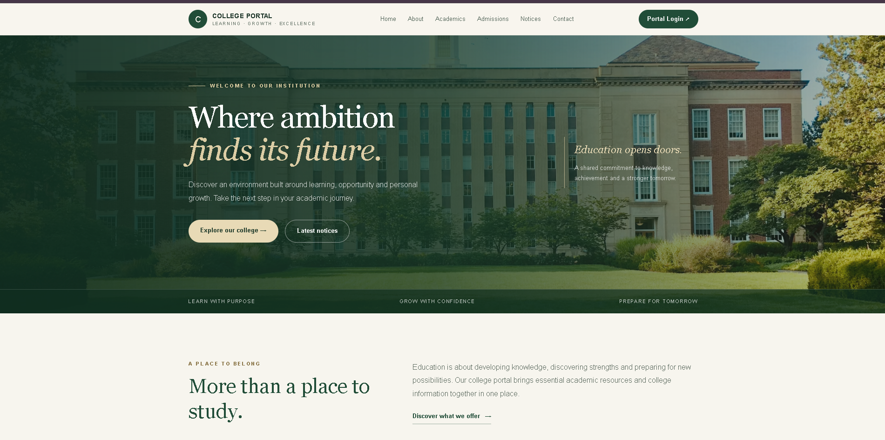
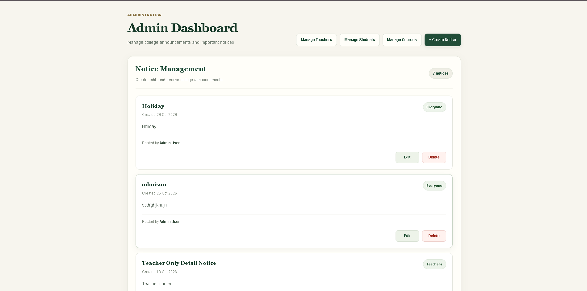
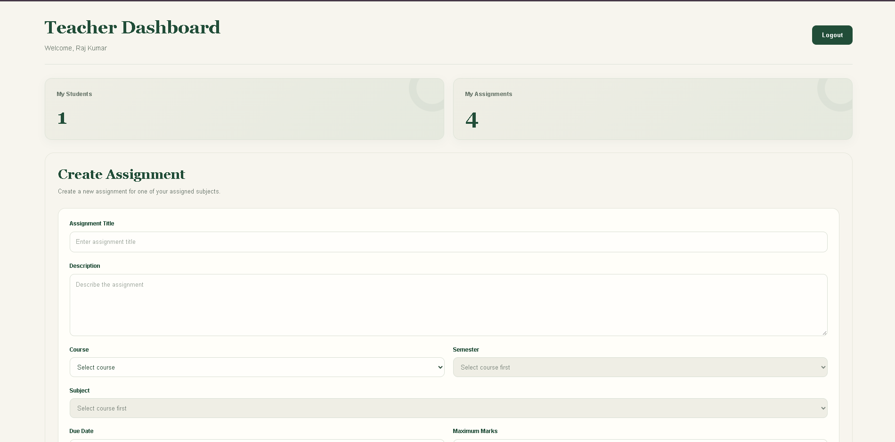
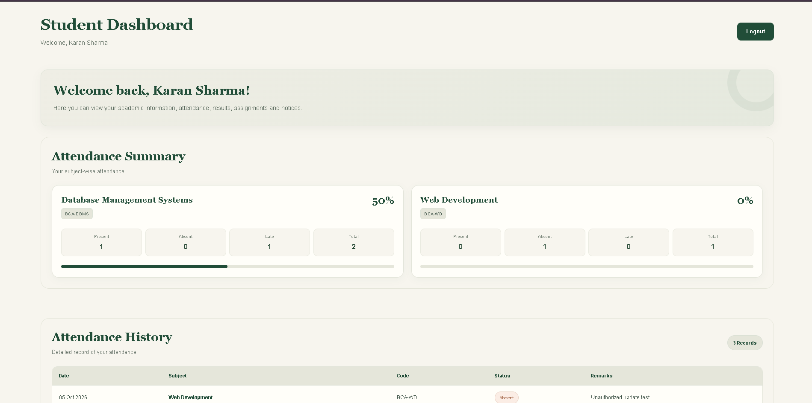

# College Management System

A full-stack college management application built to manage academic activities through dedicated student, teacher, and admin dashboards.

## Overview

The College Management System provides a centralized platform for managing students, teachers, courses, subjects, academic results, attendance, assignments, and notices.

## Features

- Role-based authentication for students, teachers, and administrators
- Dedicated dashboards for each user role
- Student and teacher management
- Course and subject management
- Student results entry and viewing
- Attendance management
- Assignment management
- Notice management
- Password recovery with email OTP verification
- Public-facing college website
- Docker-based development environment

## Tech Stack

**Frontend**
- Next.js
- React
- TypeScript
- Tailwind CSS
- TanStack Query
- Axios

**Backend**
- Node.js
- Express.js
- TypeScript
- MongoDB
- Mongoose
- JWT authentication
- Zod validation

**Tools**
- Docker
- Docker Compose
- Git and GitHub

## Project Structure

```text
college-management-system/
├── backend/
│   ├── src/
│   ├── Dockerfile
│   └── package.json
├── frontend/
│   ├── app/
│   ├── components/
│   ├── lib/
│   ├── Dockerfile
│   └── package.json
├── docker-compose.yml
└── README.md
```
## Application Screenshots

### Public Homepage


### Admin Dashboard


### Teacher Dashboard


### Student Dashboard


## Run with Docker

Make sure Docker Desktop is running.

1. Clone the repository:

```bash
git clone https://github.com/devpandey7011-ux/college-management-system.git
cd college-management-system
```

2. Configure the backend environment variables in `backend/.env`. Use the required variables from your local environment configuration. Never commit real credentials.

3. Start the application:

```bash
docker compose up -d --build
```

4. Open the application:

- Frontend: http://localhost:3000
- Backend health check: http://localhost:5000

To stop the containers:

```bash
docker compose down
```

## Run Without Docker

Install Node.js and MongoDB access first.

**Backend**

```bash
cd backend
npm install
npm run dev
```

**Frontend** — in a separate terminal:

```bash
cd frontend
npm install
npm run dev
```

Configure the necessary environment variables before starting either application.

## Project Status

The application has been tested locally with Docker, including role-based login and core student, teacher, and admin workflows.

## Author

**Dev Pandey**

GitHub: [@devpandey7011-ux](https://github.com/devpandey7011-ux)